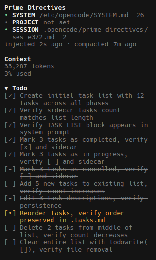
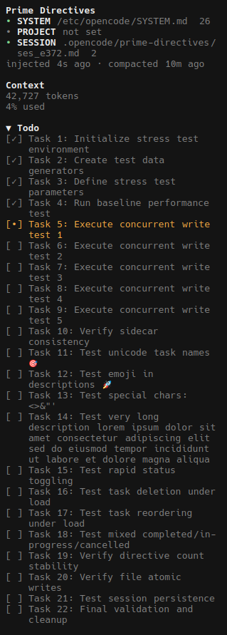

# Prime Directives

Prime Directives is an OpenCode plugin that will:
1. Manage and respect its defined hierarchy of rules and instructions; and,
2. Ensure that tasks are reliably tracked in the sidebar.

The idea is inspired by [Star Trek](https://en.wikipedia.org/wiki/Prime_Directive) in which intent and guiding principles are codified. They are rarely absolute and can be highly contextual but nevertheless are always *authoritative*.



The table below is ordered least authoritative to most authoritative.
The PROJECT layer doesn't have pre-defined priorities within it so you should write your directives in `PROJECT.md` with the contents of `AGENTS.md` in mind: indicate overrides and priority, hedge as needed, request confirmation as appropriate.

| Layer   | Source                                             | Provided by            |
| ------- | -------------------------------------------------- | ---------------------- |
| SYSTEM  | `opencode.jsonc` > `"instructions": ["SYSTEM.md"]` | OpenCode               |
| PROJECT | `AGENTS.md` (developer) + `PROJECT.md` (overlay)   | OpenCode + this plugin |
| SESSION | `.opencode/prime-directives/<sessionID>.md`        | this plugin            |

The directives are re-read on *every turn* so you can modify each layer at any point and the changes will be automatically detected and immediately integrated into the next response.
When working interactively, you may need to be very explicit when you want to perform one-time overrides for any directives. Modifying the appropriate file before proceeding and then reverting it when you're done may be more reliable.

## TUI Sidebar

There are two components: the Directive Overview and the Task List

### Directive Overview

The sidebar will enumerate each layer and its source of authority as well as the number of directives within it.
The full text of the files is read and respected but only directives prepended with a dash are counted for display purposes. For example, this would display as a single directive:
```
- Starfleet crew will obey the following with any civilization that has not achieved a commensurate level of technological and/or societal development as described in Appendix 1.
  a) No identification of self or mission.
  b) No interference with the social, cultural, or technological development of said planet.
  c) No reference to space, other worlds, or advanced civilizations.
```

### Task List

The plugin writes the task list to a per-session sidecar file (`.opencode/prime-directives/<sessionID>.tasks.md`).
If the file does not exist yet, it is created with a short heading and session ID.

- Completed items render as `[x]`
- Cancelled items render as `[-]`
- In-progress items gain an `(in progress)` note

The plugin reads from this on every turn. This ensures that tasks are not forgotten after compaction and allows for very long task lists that will be properly maintained.



> [!NOTE]
> Opencode has poor support for task lists:
> - `OpenCode V1` was not good at handling them (and this was the original impetus for the plugin); and,
> - `Opencode V2` only has experimental support.
>
> Even if task list functionality improves the layering of instructions is still useful.

## Notes

### Example command

Add this to your `opencode.jsonc` to get a `/directives` command for managing prime directives:

```jsonc
"commands": {
  "directives": {
    "description": "Add, change, or remove a persistent PRIME DIRECTIVE",
    "template": "The user wants to change the prime directive set.\n\n1. Find your prime directives file path in the PRIME DIRECTIVES block of your system\n   prompt (`.opencode/prime-directives/<sessionID>.md`). Read it if it exists.\n2. Apply the request below: add, modify, or delete the relevant directive. Delete\n   directives that are dropped rather than commenting them out.\n3. Keep the file short and normative, and do not duplicate SYSTEM or PROJECT\n   directives into it.\n4. After editing, restate the full current prime directive set for confirmation.\n\nRequest: $ARGUMENTS"
  }
}
```

### Limitations

- Workflows using parallel agents in separate worktrees will have forked PROJECT directives so a change in one will likely require changing them everywhere. The SESSION directives will be isolated and the SYSTEM directives are shared.
- I have not tested how sub-agents respond to the plugin.
- The server-client model in V2 will make the server handle the bulk of the work with the client simple displaying it. `--standalone` mode works as well.
- If for whatever reason there is no session ID the plugin should fall back to `.opencode/prime-directives/SESSION.md`. Task-list sync and the status sidecar would be skipped. This has not been tested and I'm not sure if ID-less sessions are even possible.
- I have not tested this plugin without the TUI but I don't think there is any reason it shouldn't work in the CLI or with `mini` mode. To be confirmed.
- `SYSTEM.md` will only be defined by the global config. Per-project `opencode.jsonc` files will be read but the `instruction` key's value is ignored.

